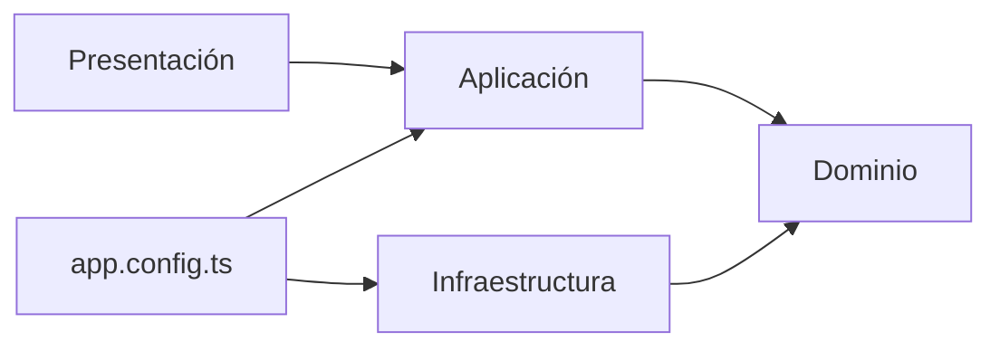

# Arquitectura orientada a dominios

El portafolio es una aplicación Angular standalone construida con Vite. Su contenido se organiza en tres contextos: **Perfil**, **Proyectos** y **Experiencia**. Cada contexto tiene modelos propios y un contrato de acceso al contenido. Angular compone sus implementaciones estáticas desde `src/app/app.config.ts`.

## Estructura

```text
src/
  main.ts                         # Bootstrap y configuración global
  styles.css                      # Tipografía, tokens y estilos globales
  app/
    app.component.ts              # Composición de la página
    app.config.ts                 # Proveedores de repositorios
    contexts/
      profile/
        domain/                   # Perfil profesional, contactos y contrato
        application/              # ProfileCatalogService
        infrastructure/           # Perfil estático y contactos desde VITE_*
        presentation/
          hero/                   # Portada
          services/               # Servicios freelance y CTA de WhatsApp
          about/                  # Biografía, narrativa y marquee
          graphics/               # Shader y contrato del horizonte
      projects/
        domain/                   # Proyecto y contrato de repositorio
        application/              # Catálogo y búsqueda por ruta
        infrastructure/
          assets/                 # Imágenes de los siete proyectos
        presentation/
                                  # Galería CSS 3D, escena de mar, modal y detalles por hash
      experience/
        domain/                   # Experiencia y contrato de repositorio
        application/              # Catálogo profesional
        infrastructure/           # Contenido de BCP y BanBif
        presentation/
          graphics/               # Escena Three.js del valle
    shell/
      controls/                   # Controles flotantes de scroll y tema
      navigation/                 # Navbar, idiomas y descarga de CV
      intro/                      # Presentación inicial y vídeo
      footer/                     # Cierre y contacto
    shared/
      assets/                     # Logo y fotografía floral compartidos
      theme/                      # Estado centralizado y persistencia del tema
      i18n/                       # LanguageService y TranslatePipe
      motion/                     # Coordinación de scroll e introducción
      ui/editorial-grid/          # Guías arquitectónicas reutilizables
```

## Responsabilidades y dependencias



- **Dominio:** interfaces TypeScript de información profesional y puertos de repositorio. No importa Angular, GSAP, Three.js ni implementaciones de almacenamiento.
- **Aplicación:** servicios de consulta que dependen de los contratos de dominio mediante `InjectionToken`. Proyectos resuelve además el proyecto correspondiente a una ruta.
- **Infraestructura:** catálogos estáticos, carga de contactos públicos desde el entorno e implementaciones de los repositorios. Aquí se elige cómo obtener el contenido, sin modificar componentes consumidores.
- **Presentación:** componentes Angular, plantillas, estilos, controles y renderizadores visuales. Las escenas WebGL pertenecen a presentación porque implementan la experiencia visual, no reglas del negocio.
- **Shell:** navegación, introducción y footer. El footer consulta los servicios de Perfil y Proyectos; no importa directamente sus catálogos estáticos.
- **Shared:** recursos técnicos comunes. No depende de un contexto de negocio.
- **Raíz de composición:** `app.config.ts` conecta contratos e implementaciones. `main.ts` entrega esta configuración a `bootstrapApplication`.

Los datos del portafolio son de lectura. Los modelos y contratos se mantienen pequeños; las operaciones de consulta se añaden cuando existe un consumidor real. Los archivos `.d.ts` junto a los renderizadores JavaScript describen el contrato usado por TypeScript y se conservan.

## Editar contenido

- Identidad, ubicación, biografía: `contexts/profile/infrastructure/static-profile.repository.ts`.
- Contacto: variables públicas de `.env`, documentadas en `docs/development.md`; su adaptador es `contexts/profile/infrastructure/contact-links.ts`.
- Proyectos e imágenes: `contexts/projects/infrastructure/project.catalog.ts` y `assets/`.
- BCP y BanBif: `contexts/experience/infrastructure/experience.catalog.ts`.
- Traducciones y metadatos por idioma: `shared/i18n/language.service.ts`.
- CV: `docs/career/CV_Camilla.md` y `docs/career/CV_Camila_Espinoza_ATS_EN.md`; exportar con `npm run cv:export`.

## Comprobaciones

`npm run check:architecture` analiza imports TypeScript/JavaScript, imports diferidos, CSS, recursos `new URL`, iconos del marquee y PDF del navbar. Rechaza dependencias entre capas no permitidas, archivos de ejecución sin conexión con la aplicación, recursos faltantes y dependencias directas sin uso. Las licencias, documentos y evidencias locales tienen una finalidad documental y no se consideran código de ejecución.

`npm run typecheck` comprueba todos los contratos TypeScript. `npm test` ejecuta las pruebas de navegador en Chrome. `npm run build` verifica la integración de módulos y recursos para producción.
